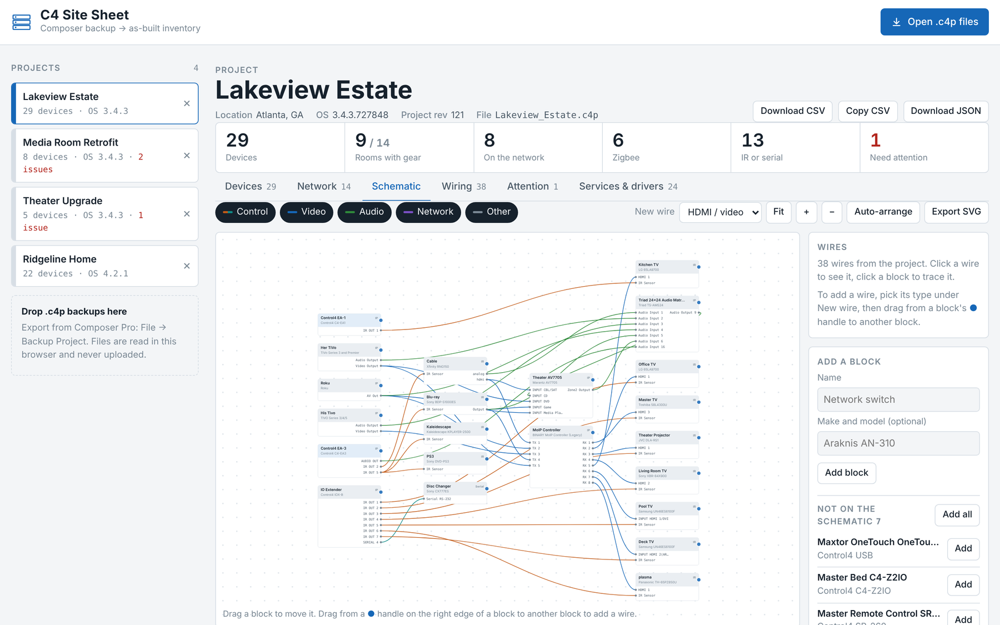
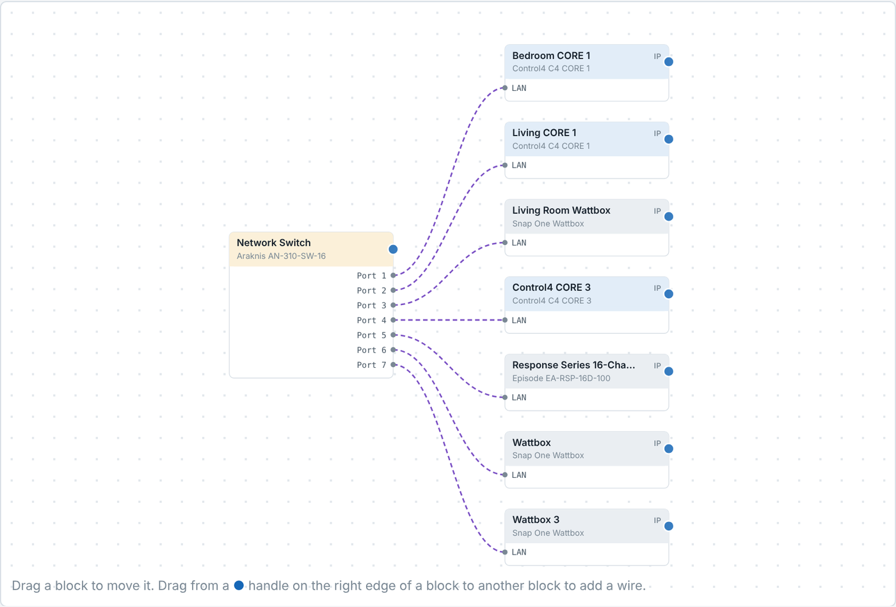
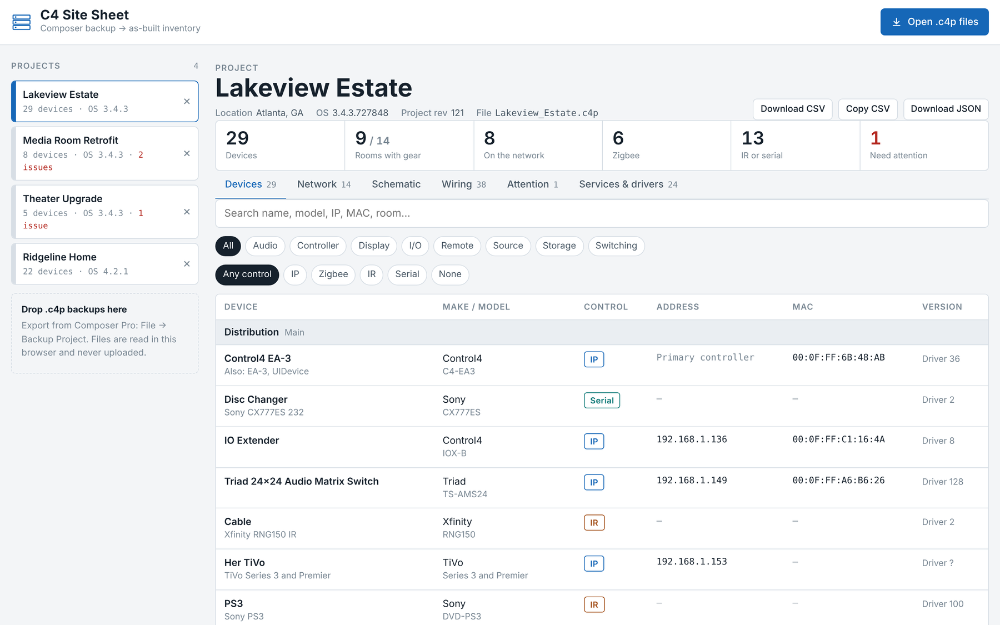

# C4 Site Sheet

Open a Control4 `.c4p` project backup and get the as-built: a signal-flow schematic, every device by room, the IR/serial and AV wiring, the network sheet, and a list of things that need attention.

**[Website](https://tjdoolittle.github.io/Control-4-Application/)** · **[Open the web app](https://tjdoolittle.github.io/Control-4-Application/app/)** · **[Download for Windows](downloads/C4SiteSheet-win_x64.exe)** (2.7 MB, portable)

Everything runs on your computer. Backup files are read locally and never uploaded.



<table>
<tr>
<td width="50%"><br><sub>Add your own blocks and wires for gear Composer doesn't know about.</sub></td>
<td width="50%"><br><sub>Every device by room with model, address, MAC and versions.</sub></td>
</tr>
</table>

Screenshots use real project backups with client names, locations, MACs and Zigbee IDs replaced.

## What it pulls out of a backup

| Section | Contents |
|---|---|
| **Devices** | Grouped by floor and room. Load or zone name, hardware name, manufacturer, model, control method (IP, Zigbee, IR, Serial), address, MAC, firmware and driver version. |
| **Network** | IP devices sorted by address with MAC and status, duplicate IPs flagged, IP drivers with no address, and every Zigbee device ID. |
| **Schematic** | Every wired device as a block with its real port names, laid out left to right by signal flow. Drag blocks, pan and zoom, click a block to trace its wires, filter by wire type. Add your own blocks (a network switch, a patch panel) and draw wires Composer doesn't know about, then rename their ports. Layout and added wires are saved per project. Export as SVG. |
| **Changes** | Open two backups of the same job and see what changed between them: devices added or removed, IP, MAC, firmware and driver changes, renames and room moves, and rebound wiring. Copy the summary for a service ticket or download it as CSV. |
| **Wiring** | IR emitters and serial runs by controller port, plus AV connections from each source output to the input it feeds. Virtual AV Path Setters are stitched through so each line shows the real input. |
| **Attention** | Devices offline when the backup was taken, duplicate IPs, IR or serial drivers with no port bound, IP drivers with no address. |
| **Services & drivers** | Streaming services, agents, virtual sources and other software drivers. |

Exports: CSV of the device inventory (opens in Excel or Sheets) and the full parsed result as JSON.

Loaded projects are remembered in this browser only, so you can switch between client systems without reopening files. Remove a project with the × next to it.

## How a .c4p is read

A `.c4p` is a zip archive. The parser uses:

- `project.xml`: the project tree (site → building → floor → room → device → proxy), network bindings (IP, SDDP id, Zigbee EUI-64) and every bound connection.
- `drivers/*.c4i` and `drivers/*.c4z` (`driver.xml` inside): manufacturer, model, control method, and the names of each connection port.
- `meta/manifest.json`: the Director OS version.

Driver properties saved in each device's state (firmware, MAC, IP, serial number) are read as well.

Tested against OS 3.4.3 and OS 4.2.1 backups.

## Files

```
index.html             landing page (GitHub Pages root)
assets/                landing page styles and screenshots
app/index.html         the app
app/css/style.css      app styles (light and dark)
app/js/parser.js       the .c4p parser; works in the browser and in Node
app/js/app.js          the interface
app/js/schematic.js    the schematic builder
app/js/compare.js      compares two backups; works in the browser and in Node
app/js/sample.js       an invented example project shown before any file is opened
desktop/               Windows/Mac/Linux desktop build (Neutralinojs)
downloads/             the current Windows exe, linked from the landing page
test/parse-test.js     prints the parsed inventory for one or more backups
```

## Running it

Serve the repo root with any static server: the landing page is `/` and the app is `/app/`. On GitHub Pages: Settings → Pages → Deploy from branch → `main`, `/ (root)`.

To check the parser against real backups from the command line:

```
npm install
node test/parse-test.js path/to/Project.c4p
node test/compare-test.js older.c4p newer.c4p
```

`.c4p` files are git-ignored so client backups don't end up in the repo.

## Windows desktop app

`desktop/` wraps the same site files into a single portable `C4SiteSheet-win_x64.exe` (about 3 MB) using [Neutralinojs](https://neutralino.js.org). It uses the WebView2 engine built into Windows 10 and 11, works offline, and saves CSV and JSON exports through a normal Save dialog.

Build it (Mac and Linux builds come out at the same time):

```
npm install
bash desktop/build.sh
```

The executables land in `desktop/dist/C4SiteSheet/`. Copy the Windows one to `downloads/C4SiteSheet-win_x64.exe` to update the landing page download. The exe is unsigned, so the first launch shows Windows SmartScreen: choose **More info → Run anyway**.
